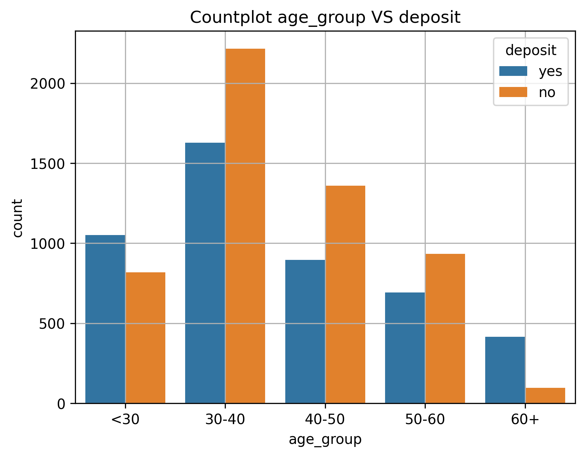
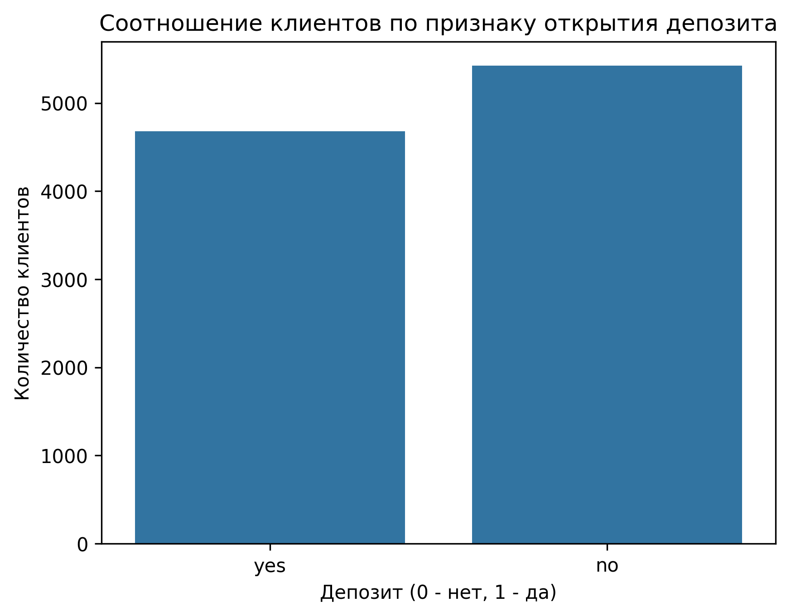
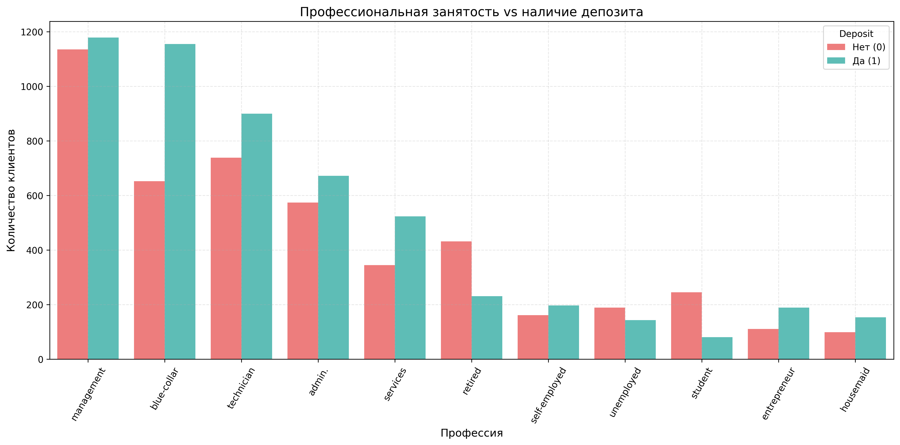
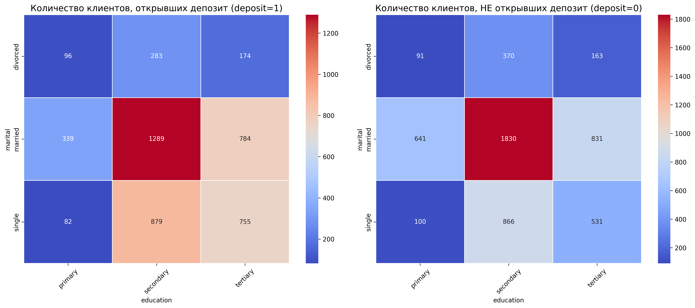
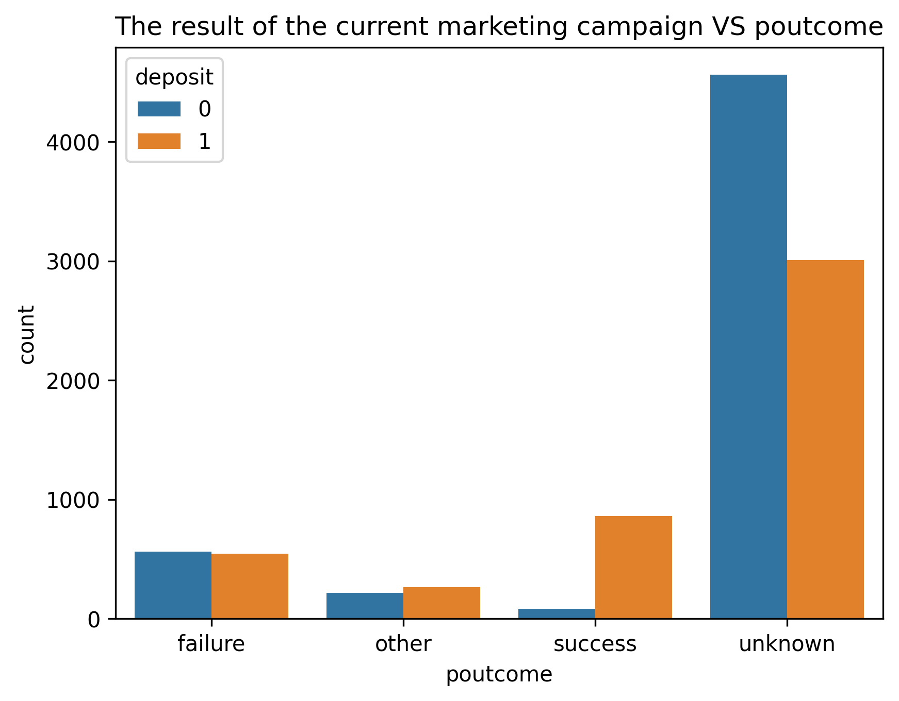
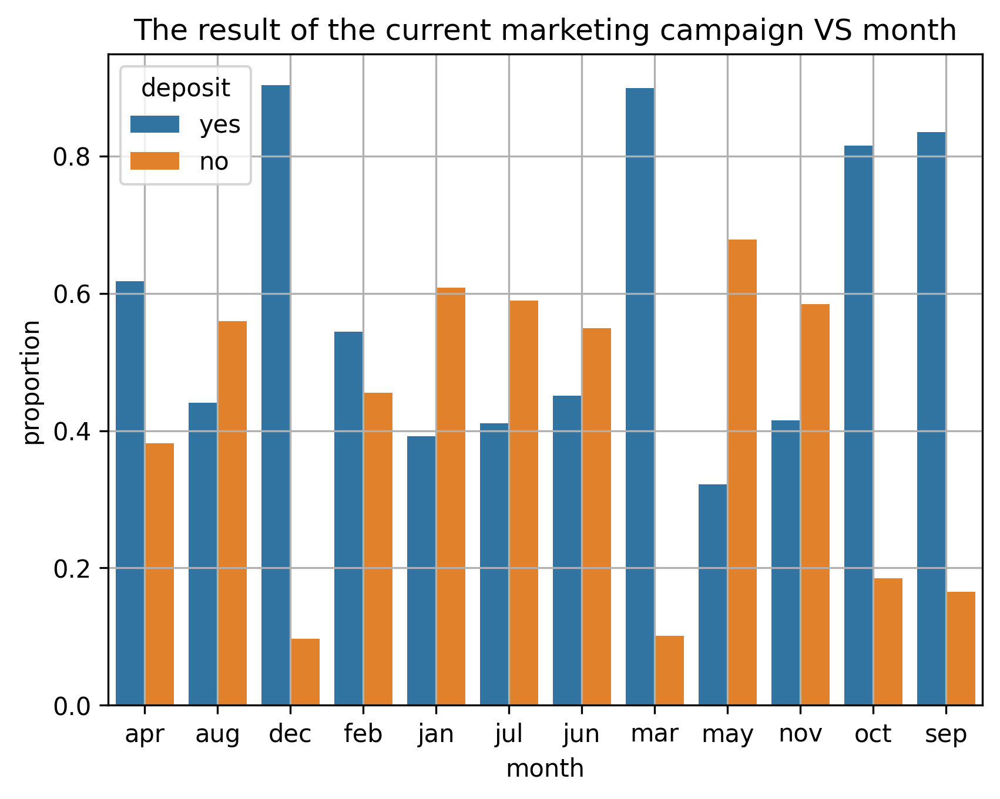
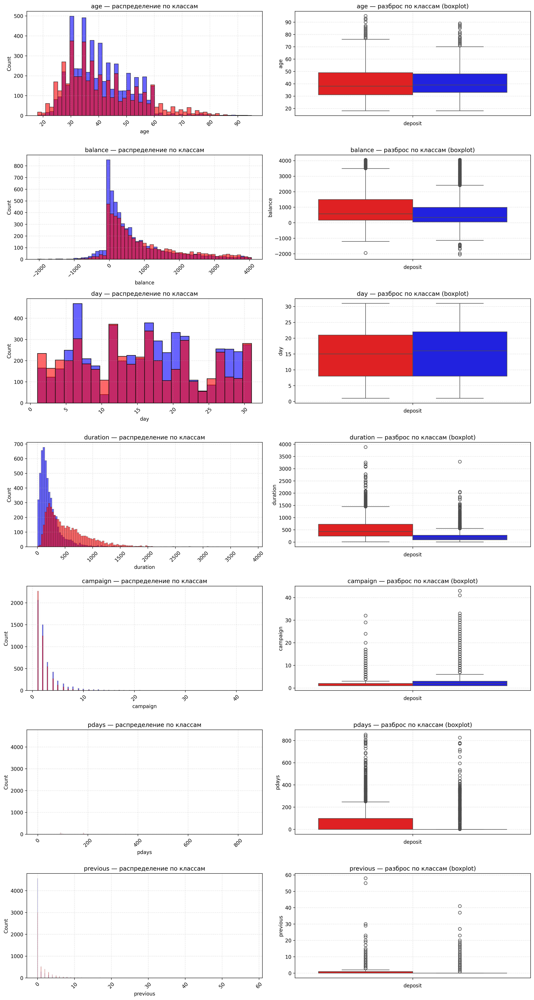

# <center> **Prediction of Deposit Subscription (Bank Marketing)**

ML-проект по предсказанию подписки на срочный вклад на основе данных маркетинговой кампании банка. 

## **Оглавление**
1. [Описание проекта](#Описание-проекта)
2. [Описание данных](#Описание-данных)
3. [Зависимости](#Зависимости)
4. [Установка проекта](#Установка-проекта)
5. [Использование проекта](#Использование-проекта)
6. [Результаты и выводы](#Результаты)
7. [Авторы](#Авторы)


## 1. Описание проекта

**Цель проекта** — максимизировать ROC-AUC при сохранении интерпретируемости и контроле бизнес‑рисков.

**Задача:** на основе данных о клиетах банка и маркетинговых кампаниях предсказать, согласится ли клиент открыть депозит в банке.

**Основные этапы выполнения проекта:**
* загрузка и предобработка данных
* разведывательный анализ данных (все графики EDA сохраняются в папку `experiments/`)
* создание универсального preprocessor = ColumnTransformer
* пайплайны:
    * Baseline - DecisionTreeClassifier
    * DecisionTreeClassifier с GridSearchCV
    * LogisticRegression 
    * RandomForestClassifier
    * GradientBoostingClassifier
    * StackingClassifier (на всех признаках)
    * Отбор Топ‑12 самых важных признаков
    * Препроцессор → RFE → классификатор (Топ‑3)
    * RandomForest + Optuna
* выбор модели с максимальной метрикой и построение ColumnTransformer + best_model на отобранных признаках
* все результаты работы логируются
* вывод
---

## Структура проекта

Проект организован по модульному принципу: 
- логика вынесена в `src/`, 
- данные изолированы в `data/`, 
- результаты экспериментов хранятся в `experiments/`,
- модель сохраняется в папку `models/`.

```
Project-4_Clean/ 
|
├── README.md                           # Документация к проекту (Этот)                                                                
├── .gitignore                          # Игнорируемые файлы 
├── requirements.txt                    # Список зависимостей Python 
├── data/                               # Исходные и предобработанные данные 
|   ├── README.md                       # Описание файлов данных и источников
|   ├── .gitkeep                        # Маркер непустой папки для Git  
|   └── bank_fin.csv                    # Данные клиентов и маркетинговых кампаний 
|     
├── experiments/                        # Результаты экспериментов  
|   ├── plots.png                       # Файлы графиков экспериментов и EDA
|   ├── experiments.json                # Файлы экспериментов .json
|   └── summary.csv                     # Лог всех запусков (модель, параметры, метрики) 
|
├── models/                             # Сохраненная модель 
|   ├── model.pkl                       # Модель 
|   └── model.json                      # Лог модели
├── notebooks/                          # Jupyter Notebook с основным пайплайном 
│   └── classification.ipynb 
|
└── src/                                # Модули проекта (вынесенная логика)  
    ├── init.py                         # Инициализация пакета src  
    ├── data_utils.py                   # Функции загрузки данных  
    ├── features.py                     # Генерация признаков   
    ├── experiment_logger.py            # Логирование результатов в summary.csv и сохранение графиков
    └── .pycache/                       # Кэш скомпилированных Python-модулей (игнорируется Git)
```
---
### Назначение ключевых модулей

- **`src/data_utils.py`**: Отвечает за загрузку CSV-файлов из папки `data/`. 
- **`src/features.py`**: Центральная логика создания признаков. 
- **`src/experiment_logger.py`**: Автоматически фиксирует параметры модели и метрики в `experiments/summary.csv` после каждого запуска.
- **`notebooks/classification.ipynb`**: Основной ноутбук, который импортирует функции из `src/` и управляет пайплайном обучения.

---
2. ## Данные

Используемые датасеты:

1. **Основные данные о клиентах и маркетинговых кампаниях**: `bank_fin.csv`:

* **Данные о клиентах банка:**
    * age (возраст);
    * job (сфера занятости);
    * marital (семейное положение);
    * education (уровень образования);
    * default (имеется ли просроченный кредит);
    * housing (имеется ли кредит на жильё);
    * loan (имеется ли кредит на личные нужды);
    * balance (баланс).

* **Данные, связанные с последним контактом в контексте текущей маркетинговой кампании:**
    * contact (тип контакта с клиентом);
    * month (месяц, в котором был последний контакт);
    * day (день, в который был последний контакт);
    * duration (продолжительность контакта в секундах).

* **Прочие признаки:**
    * campaign (количество контактов с этим клиентом в течение текущей кампании);
    * pdays (количество пропущенных дней с момента последней маркетинговой кампании до контакта в текущей кампании);
    * previous (количество контактов до текущей кампании)
    * poutcome (результат прошлой маркетинговой кампании).

* **Целевой признак:**
    * deposit - согласится ли клиент открыть депозит в банке

---
### Оценка качества

**Метрика**:  ROC‑AUC (основная), Accuracy, Precision, Recall, F1‑score


## Используемые зависимости
* Python (3.10):
    * pandas=2.0.1
    * numpy=1.24.2
    * scikit-learn=1.2.2
    * scipy=1.15.3
    * matplotlib=3.10.8
    * seaborn=0.13.2

---
## Установка проекта

```
git clone https://github.com/vavilove001-lab/Prediction-of-Deposit-Subscription-Bank-Marketing-
```

---
## Использование

1. Clone the repo:
   ```bash
   git clone https://github.com/vavilove001-lab/Prediction-of-Deposit-Subscription-Bank-Marketing-
   cd trip-duration-prediction
2. Install dependencies:
    ```bash
    pip install -r requirements.txt
3. Download data files (see data/README.md) and place them in data/
4. Run the notebook:
notebooks/classification.ipynb

---
## Результаты и выводы
* Распределение возрастов относительноцелевой переменной

* Распределение категориальных признаков

* Сбалансированность классов целевой переменной

* Распределение рода деятельности относительно целевой переменной

* Распределение семейного положения и уровня образования относительно целевой переменной

* Тепловая карта распределения признаков семейного положения и обучения относительно таргета

* Влияние результатов маркетинговой кампании относительно результатов прошлой кампании

* Распределение отказов открыть депозит по месяцам

* Распределение числовых признаков


## Результаты экспериментов

Все запуски в хронологическом порядке. Baseline — DecisionTreeClassifier (ROC-AUC 0.870).

| Модель                            | ROC-AUC   | Accuracy  | F1-score  | Признаки | Особенности                                    |
|                ---                | ---       | ---       | ---       | ---      | ---                                            |
| DecisionTreeClassifier            | 0.870     | 0.795     | 0.767     | 37       | Базовая модель                                 |
| LogisticRegression                | 0.907     | 0.831     | 0.816     | 37       | Линейная модель, хорошая калибровка            |
| RandomForest (GridSearch)         | 0.914     | 0.843     | 0.809     | 37       | Ансамбль деревьев, подбор гиперпараметров      |
| GradientBoosting (GridSearch)     | 0.923     | —         | —         | 37       | Усиление слабых сигналов                       |
| RandomForest (Optuna)             | 0.916     | 0.844     | —         | 37       | Оптимизация через Optuna (TPE), 40 испытаний   |
| **StackingClassifier (Top‑12)**   | **0.925** | **0.859** | **0.852** | **12**   | **Финальная модель**                           |
> **Отбор топ‑12 признаков по важности RF, пересобранный preprocessor** 

> Полный лог — `experiments/summary.csv`.

---
### **Интерпретация результатов**
Последовательное улучшение ROC‑AUC от базовой модели (DecisionTree, 0.870) до финальной (Stacking, 0.925) отражает правильную стратегию ML‑проекта: от простой модели к ансамблю с контролем сложности.

**Ключевые наблюдения:**

- **Прогрессия качества.** Переход от линейной модели (LogisticRegression, 0.907) к ансамблям деревьев (RandomForest, GradientBoosting) стабильно повышает качество: слабые сигналы, которые линейная модель не видит, эффективно улавливаются деревьями.
- **Эффект отбора признаков.** Финальная модель Stacking на 12 признаках превзошла все модели на полном наборе (37 признаков): ROC‑AUC вырос с 0.923 до 0.925, а F1‑score — с отсутствующего/низкого до 0.852. Это говорит о том, что в исходных 37 признаках была избыточность и шум, который мешал обобщению.
- **Баланс точности и полноты.** F1‑score 0.852 у финальной модели показывает, что Stacking хорошо балансирует между Precision и Recall: модель не только находит большинство целевых клиентов (Recall), но и делает это с высокой точностью (Precision), что критично для бизнес‑ресурсов.
- **Контроль переобучения и интерпретируемости.** Сокращение числа признаков с 37 до 12 снижает риск переобучения, особенно при работе с несбалансированными классами. Кроме того, меньшее число признаков делает модель понятнее для бизнеса: проще объяснить менеджерам, на какие именно факторы (длительность контакта, баланс, возраст и т.п.) стоит обращать внимание.
- **Роль стекинга.** Комбинация разнородных базовых моделей (деревья и линейные модели) позволила ансамблю использовать сильные стороны каждого типа: деревья — для нелинейных зависимостей, линейные модели — для стабильных обобщений.
- Таким образом, финальная модель не только показывает лучшие метрики, но и является более устойчивой, интерпретируемой и пригодной для внедрения в бизнес‑процессы.
- Среди топ‑12 признаков оказались ```duration``` (длительность взаимодействия) и ```balance_log``` (логарифм баланса клиента) — это подтверждает гипотезу, что на конверсию сильнее всего влияют вовлечённость клиента и его платёжеспособность. На основе этих признаков можно сформулировать простые правила для менеджеров: уделять повышенное внимание клиентам с высокой длительностью контакта и средним/высоким балансом.


---
## Способы улучшения метрики
* Калибровка вероятностей. Сейчас Stacking выдаёт «сырые» вероятности, которые могут быть смещены. Стоит добавить CalibratedClassifierCV поверх финальной модели (метод Platt scaling или isotonic). Это почти не меняет предсказания классов, но сильно улучшает качество вероятностей и, как следствие, ROC‑AUC и калибровку для бизнеса.
* Более тонкая настройка стекинга. Сейчас мета‑модель обучается на предсказаниях базовых моделей. Стоит попробовать:
поменять мета‑алгоритм (с LogisticRegression на RidgeClassifier или даже простой GBM);
использовать out‑of‑fold предсказания (через cross_val_predict или StratifiedKFold) для обучения мета‑модели — это снижает переобучение и часто даёт прирост.
* Доработка отбора признаков. Я взял топ‑12 по важности RF. Можно попробовать добавить к ним признаки с высокой корреляцией с целевой переменной, но низкой корреляцией друг с другом (MIFS‑подход). Иногда 1–2 «тихих» признака дают заметный прирост без потери интерпретируемости. 

---
## Авторы
* [Вавилов Павел](https://github.com/vavilove001-lab)